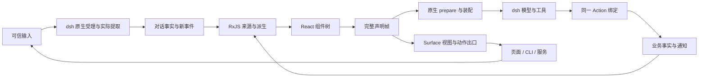

# 架构与责任

dsh-reactive 将业务程序接入 dsh 的多工作区、多会话运行环境。React 管理后台组件树及其身份，RxJS 组合事实与事件，dsh 执行模型步骤、原生工具和 Goal。组件提交的完整声明帧把这三者连接起来。

程序运行在服务端或 Agent 宿主。页面、CLI、后台服务与原生会话 UI 消费公开观察并显式参与，页面是否挂载不决定会话程序是否存在。

## 程序定义与组件树

`defineProgram({ input, surface })` 声明可跨宿主与客户端共享的纯合同。`implementProgram(program, { Component })` 将宿主组件绑定到这份合同，组件不进入共享定义。`defineEnvironment` 将程序实现、静态指令与静态 Skill 目录组成可复用场景，`defineApplication` 声明环境集合及输入准入。

Workspace 由原生 registry 持有目录、稳定身份与成员。`createWorkspace({ directory, title })` 注册已存在的绝对目录，`create(environmentId, { workspaceId })` 显式组合场景和工作区。同一场景可以用于多个工作区，同一工作区也可以运行不同场景。会话自己的持久 binding 决定 application、environmentId 与 workspaceId，宿主交叉核验 Preset、header.cwd 及原生成员；不根据目录猜测场景，也不另存一套环境映射。

根组件取得对话身份、输入及活动流、后续新事件和显式 `submit`，也取得工作区身份与共享来源接点。组件通过标准 React 组合、条件分支与 key 管理业务模块，通过 RxJS 派生查询和事件关系。后台 declaration renderer 不生成 DOM；其输出是 `Context`、`Offer`、`Follow`、`Expose`、`Skill` 与 `HumanInput` 声明。

相同组件类型在相同位置及 key 下保留 React 状态与 hooks 身份。`useAction` 的目标构造函数与依赖决定业务绑定是否复用；Context 名称、Offer 名称、Surface 对象和出口槽名各有明确合同。模块实例的路径来自 `composeSurface` 的合同树，React key 不自动成为原生工具名或公开出口名。

可复用业务模块定义自己的局部 Surface，使用局部 Context、Offer、Follow 与 Expose。应用通过 `composeSurface` 组合模块合同树，再用其签发的挂载点建立 `Module` 边界。框架统一生成稳定的原生名称和根 Surface 的精确槽映射，模块不接收应用自定义 names 或 Outlet，也不导入应用根 Surface。Offer 可以直接使用 Action 合同名，Context 和 Follow 的局部名只须在模块实例内唯一。

组合结果保留各叶合同身份，SDK 使用如 `a.knowledge.facts`、`a.knowledge.initialize` 的精确类型化路径。`selectSurface` 选择模块公开的视图、动作和操作；未选择的参与面不进入该根 Surface，但不改变模型工具声明或业务权限。挂载点有运行时身份，空模块也参与完整帧的归属与重复核验；错误根合同、重复挂载和名称过长均硬失败。原生名字采用无歧义的路径编码，不截断或猜测；组件重排不改变路径，业务操作身份仍来自原 Action 和 owner。

变化中的业务对象集合使用 `collectionSurface(localSurface)`，根合同不随成员改变。`mount.instance(key)` 保留完整业务 key，框架签发独立的原生名称；嵌套 Module 的合同、选择和地址由外层挂载自动重定位。本地与远程 SDK 均使用 `collection(name).instance(key)` 及本地槽名，`instances$` 来自真正提交的挂载成员。移除会撤下入口和所属观察，重挂生成新绑定；已接受执行及业务 Operation 保留原 owner。动态地址只负责寻址，实际调用继续核目标、绑定及参与者权限。

`combineResources` 与 `mapResource` 在标准 Observable 上保留资源有效性。跨域规则可以把准备、知识和接待事实派生成共享协作前提，同一派生同时驱动 Context、Offer 与公开资源；任一依赖 pending/error 都使当前派生失效。组合代次只属于本订阅，不声明跨业务服务事务一致性。共享和释放使用现有 RxJS owner；资源派生不自动重发命令、登记持久等待或取得 Goal 权限。

持续依赖也有方向：知识前提只依赖准备和知识，接待前提再依赖接待现场，不能让下游接待查询反过来阻断知识修复。`switchResource` 在上游失效时退出旧查询，依赖恢复时重新连接 owner。Context 默认必需并进入原生准备等待；显式 `required:false` 的模块现场在 pending/error 时从声明帧撤下，其公开资源保留真实状态、关联能力按条件撤下，其他有效模块可以继续工作。

## 运行责任

| owner | 拥有的责任 |
| --- | --- |
| React | 组件求值、树结构、key、hooks 与 effect 的挂载和清理 |
| RxJS | Observable 的组合、订阅、切换、并发、调度、错误与终止 |
| dsh | 会话、inbox、模型循环、工具管线、PTC、Goal、持久化、查询与投影 |
| 业务应用 | 权威事实、权限、业务修订、副作用、可靠任务及正式完成条件 |
| dsh-reactive | 程序 owner、完整声明帧、原生装配、Surface 出口及输入和调用的因果关联 |

内部 scope、cell 和资源快照用于持有连接、等待就绪及核验装配。业务组合继续使用 React 和 RxJS；模型与工具继续进入 dsh 的执行管线。

业务自定义 hook 可以直接返回资源、Action 和标准 Observable，供下一层业务 hook 继续派生。`invocations$` 表达新发生的调用，`activeInvocations$` 表达本绑定当前在途调用集合；单次 `Invocation.activity$`、`result` 和独立 `operation` 不合并为一个 loading 或完成标记。晚观察者读取当前集合不会重发命令，内存集合也不承担跨重启任务恢复。

`NativeTools` 声明宿主已经安装的原生能力及业务政策。框架不重新注册同名工具，仍由原生实现和所有 guard 执行；异步政策返回后核验当前声明，模型可见性与生成的 PTC SDK 使用同一原生限制。业务文件系统的只读材料、草稿范围和路径准入继续由真实宿主实施。

`actionManifest$` 提供工具名与 Action、模块完整路径、绑定和公开槽的关联；原生与 PTC 的持久结果 metadata 提供同源 canonical 输出。原生 UI slot 可以按实际工具名挂业务呈现，通过 `readActionPresentation` 读取合同结果，不反解命名编码或解析模型正文。它不定义业务卡片组件或视觉布局。

固定 dsh `0.2.1-rc.3` 的 SessionController 内部直接创建私有 Agent、命令和历史控制器，并持有文件上传 resolver，尚无统一公开宿主接点。原生创建、历史 promote、预上传、composer 和队列 mutation 需要上游在执行前委托同一 Program Host；post-commit 观察无法替代准入。当前本地与 Gateway SDK 已使用框架受理入口，原生 UI 直接调用 Controller 的完整接入仍待该上游能力，不通过私有替换或放宽身份核验完成。

组件求值与声明构造保持纯投影。它们不注册工具、不连接查询、不执行 Action。查询连接由提交后的观察及出口 owner 持有；长期事件关系由 `useRelation` 的 effect 持有。明确的 Action 调用才开始业务执行。

## 完整声明帧与稳定身份

renderer 在 React commit 后收集整棵树的声明，经过私有运行时品牌校验及 collector 合并，再交给会话的 `ProgramInstance`。渲染或声明失败进入程序错误边界，不能发布一个空帧来掩盖失败。

`Context` 提供 JSON 快照或保留 pending/error 的资源观察；`Offer` 将一个已有 Action 绑定以显式名称和 enabled 状态提供给模型；`Follow` 为已绑定原命令的 Operation 提供新的参与能力；`Expose` 贡献视图、动作或只读操作槽；`Skill` 选择原生方法正文或提供明确目录。

同名 Context 复用其资源接点并更新当前观察。相同 Offer 名称与 Action 绑定复用能力身份；enabled 决定当前是否进入原生工具表。相同视图来源对象保留查询连接，替换来源才断开旧连接。静态 Skill 装配及仍在声明中的动态目录也保留各自原生 owner。

一帧中的声明更新通过内部 batch 发布，revision 让异步准备能够发现等待期间的变化。整帧提交不等于把全部组件、Action 或工具重新挂载。原生工具定义以具体 Agent 和绑定为归属；同一会话程序恢复到新 Agent 时，需要取得新 Agent 的执行闭包。

## 原生装配

每个应用与环境共同确定稳定 Preset 身份。Loader 登记的环境插件在原生 standing scope 中持有静态指令、静态 filesystem Skill provider 和作用域内的 Agent 接入。创建与恢复均挂载精确的 Preset，session header 与工作区绑定共同核验身份。原生 registry 持有 standing scope 的代际引用，宿主先释放自己持有的 Agent handles，再退休声明。

动态 Context、Offer 和 Skill 接在具体 Agent 上。原生 loop 提取本步输入后先进行 `system-prompt/assemble`，再执行 `agent/pre-step`。宿主在 assemble 边界更新输入关联、核验应用准入、冲刷组件声明，等待当前上下文、步骤检查与选中 Skill，随后通过公开 API 重新装配。

准备期间的帧替换、上下文失效或 Skill catalog 变化会使稳定性检查失败，宿主重新读取当前集合。Context 只把准备完成的文本交给原生 prompt provider；模型请求保留该步骤取得的装配，工具实际调用时再核验当前绑定与可用性。业务权限、数据修订和副作用条件仍由业务 owner 核验。

动态 Skill 目录由 Agent scope 下的原生 filesystem provider 持有，其 catalog 与工具调用沿原生 SkillRegistry 工作。`Skill` 的 name 声明在当前 scope、cwd 和取消信号下加载既有方法，以原生 `renderSkillContent` 生成正文并贡献 required context；它会实际改变模型取得的方法现场。

## Action 的三类入口

`defineAction` 只保存共享合同与可选 Operation 映射，`implementAction` 保存宿主执行与实际业务 owner。`useAction` 将实现绑定到不可变业务目标，同一个绑定可以提供给模型、程序和公开出口。Action 定义对象本身决定合同身份，结构相同的另一对象不自动成为同一合同。

| 入口 | 当前接线与归属 |
| --- | --- |
| `Offer` 对应的模型工具 | 进入原生工具及 PTC 管线，携带真实 callId、rootCallId、parentCallId、已消费输入和适用 Goal continuation |
| 组件程序显式调用绑定 | 宿主以配置的 serviceActorId 建立服务参与身份，携带独立 invocationId，不借用当前模型的输入或 Goal 权限 |
| 同进程句柄的 `resolveAction` | 按调用者明确期望的 scope 捕获 `Expose` 的实际绑定；调用以可信选项或宿主 actorId 建立 human 参与身份，执行前核验同一绑定 |

远程宿主从同一 Surface 合同分派到实际绑定，调用者身份由认证载体取得。各入口共用绑定的解析与准入链；独立调用不因参数中出现 callId 或 Goal 引用就取得原生调用权限。

声明撤下会阻止后续受理。已经进入执行的 Action 沿原调用信号和业务 owner 继续结算；Invocation 的结果和活动观察不受消费者订阅次数控制。业务结果返回、原生工具最终结算与业务任务正式完成各有自己的事实来源。

## 长期业务操作与人工参与

Operation 是业务系统已有操作的类型化观察对象。Action Invocation 返回受理回执后，Operation 继续由业务 owner 持有；组件、页面和当前函数退出不改变其寿命。共享合同中的 settled 描述操作终态，feedback schema 描述协作节点 payload；owner 按确切登记读取带稳定 id 的反馈。

Offer.follow 接合原调用、原工作、命令、正式引用和等待。原生 reactiveOperations 投影只保存这份因果关联及固定投递，不保存或调度业务任务。业务 owner 使用已有可靠设施登记关联和投递通知，框架按真实 owner 事实与精确 Goal 修订决定是否能够继续。

后续工具调用通过 Follow 为同一原 command 登记新参与，after 指出业务节点边界。新参与使用本次调用的输入和 Goal 修订，原投递保持不变。owner 可为新登记建立新的观察尝试；同节点重放不再观察，进程恢复也不重新执行业务动作。原任务的正式结果与某次观察产生的调查要求分别保存。

归属树、响应依赖图和因果关系分别存在：组件拥有查询连接，RxJS 决定变化传播，持久原调用决定结果归属。两个会话可以观察同一业务操作，它们不会因此共享 Goal 权限。

HumanInput 把响应者准入与当前程序一起组合。实际提出问题、前台等待、客户端 claim、超时继续与迟到回答沿原生服务；持久问题和瞬态前台请求对外分别观察。输入提交权限、人工答复权限及正式业务批准分别核验。

真实工具调用中的 Action 可通过 askHuman 主动请求补充信息，框架将它作为实际 programmatic 子调用接回标准工具与问答服务。调用体拥有这次等待，退出时取消并等待未完成提问；超时返回 pending 后，晚答继续属于原对话，不恢复原函数栈。普通 SDK 参与者不因此取得原生工具或 Goal 身份。

## Surface 与跨进程边界

Surface 显式列出视图 schema、Action 定义与只读 Operation 定义。多个子组件可以向同一 Surface 贡献不同槽，collector 对重复槽硬失败；类型检查和运行时校验共同拒绝未知槽、错误来源与不同合同身份。

operations 槽的 resolver 从当前声明取得原 command，之后的查询保留这份绑定；旧句柄不会因组件切对象而重定向。已登记参与还可以按持久身份单独恢复读取，不要求当前组件继续公开它。读取与新参与登记是不同接口，SDK 不能通过只读句柄借用当前 Goal 权限。

输入的持久原值和事件 wire 保持 JSON；`Program.input` 在本地程序与远程客户端的读侧解析成领域值。单向输入 transform 不承担视图的反向编码责任。`InputReference.sourceSessionId` 标明消息真实所属会话；每个程序只解析本会话输入，跨会话 cause 保留原合同下的原始值和来源，不塞入当前程序的 typed 输入集合。

`view(schema)` 明确消费值事件，`resourceView(schema)` 明确消费资源 Observation；后者保留 pending/error，只有 ready 才产生领域值和 wire。两者的本地 SDK 均使用 `z.output` 领域类型。出口持有一次来源连接，并用同一 schema 的 `z.encode` 得到 wire 值，再核验其确实是 JSON。普通验证 schema 可以使用恒等方向，单向 transform 不能冒充可逆编码；Date 等领域值需要显式双向 Zod codec。

同进程观察保留领域值，跨进程观察发送已经编码的 wire 值。公开 `encodeView`、`decodeView` 供调用方复用同一 Surface 合同；JSX 返回值本身不承担跨进程编解码。Surface 及其映射壳会冻结，外部业务源不被深度冻结。

## 生命周期与持久因果

| 范围 | 生命周期 |
| --- | --- |
| 工作区 | 持有明确共享的查询连接与权威会话成员关系 |
| 会话程序 | 持有后台组件树、声明、公开出口及组件关系 |
| 组件子树 | 退出时撤下其声明并清理所属查询和关系订阅 |
| 原生 Agent | 持有模型驱动、原生 scope、动态工具和 Skill provider |
| 消费者句柄 | 持有自己的观察订阅，释放时不撤销已受理业务 |

同宿主关闭与恢复可以在仍有句柄的情况下保留会话组件程序，同时替换原生 Agent。冷 `open` 可以从持久记录重建程序而不加载驱动；`resume` 和主动输入才进入驱动路径。进程重启重建当前程序与持久关联，React 局部状态和 JavaScript 调用栈不作为可靠业务任务保存。

业务模块退出只撤下当前声明和查询。原请求、工具调用、业务操作、等待及 Goal revision 的持久因果继续归原生会话与原业务 owner；组件清理不能顺手取消原业务操作、抹去等待或把新对象接到旧操作上。

实时与冷观察复用原生 session projection/query。`reactiveInputs` 单元只记录框架拥有的请求、输入、调用、Goal 与等待关联；原生 inbox 是受理输入的权威来源。持久回执不代表模型已消费、工具已返回或业务已完成，跨业务事务与会话日志的可靠投递继续使用业务已有设施。

请求观察从同一会话事实按原 requestId 派生。助手流的 start 固定本步整组输入；活跃前缀由官方 AssistantStreamAccumulator 保存，后续只接受原生增量，持久结算仍归 session。远程开场发送当前快照，后续传活动更新、原生流帧和新事件；SnapshotStream 与 JournalStream 分别承担恢复，不增加另一份请求投影、游标或回复状态机。观察与日志读取都不提升冷 Agent。

多个业务等待按 Goal id 与 revision 分组。ready 完成事实先在原生关联投影解除自己的等待，再进入原生 next-step inbox；只有该修订已无其他等待、目标仍 active 且有剩余轮次时，结果才有自动唤醒资格。模型步骤最终执行前仍重新核权。暂停期间已 claim 但未消费的结果保留同一消息身份；显式取消不把它重新放回队列。人的新修订有独立权限，旧等待不能阻止它，旧结果也不能取得它的续接权限。

## 实现边界

仓库根是私有 npm 工作区，管理统一配置、工具、示例和行为试验。六个正式发行包均位于 `packages`；每个包有独立 manifest、exports 和构建入口。以下核心能力域均位于 `packages/core/src`。

`applications` 与 `environments` 定义应用准入和环境配置；`conversations` 拥有输入协议、对话事实及请求观察。`actions`、`operations` 分别持有调用与长期操作的合同、绑定和 owner 接点，`participation` 定义人工参与，`collaboration` 定义子工作协作合同，`tools` 定义原生能力准入。

`surfaces` 持有纯公开合同、组合与集合地址、客户端消费和出口连接；组合挂载点的身份与映射也在该域，不依赖 React。`resources` 持有资源定义、参数实例、有效性、查询和派生；`reactions` 持有持续感知与显式运行的合同、实例和结算，直接消费标准 RxJS 并发操作符。`reactivity` 提供同步响应 owner、Observable 与取消信号互操作。`program` 负责 React 实现、Module、hooks、声明、renderer 和完整帧，作为 `@hanger-source/dsh-reactive/program` 的显式入口。根合同入口不静态导入它；`@hanger-source/dsh-reactive/kernel` 是宿主扩展接点，由真实宿主显式加载。

`packages/dsh` 作为独立的 `@hanger-source/dsh-reactive-dsh` 包装配原生服务、模型、关联、查询、投影和准备边界，Jobs、MCP、Approval、时区各有显式可选入口与配置实例。`packages/remote` 贡献认证 Gateway/Typert 宿主；`packages/client` 是独立客户端发行包，承载纯 wire 合同与官方生成的 remote contribution，不依赖原生宿主、模型 provider 或 React。`packages/native-ui` 将真实 Action manifest 接到 dsh 原生 keyed Tool slots，并读取原调用的持久结果；它由应用显式选择，不进入其他包的安装闭包。

宿主的 `conversations` 分别持有会话与 live Agent 的关联、输入受理事务、句柄和原生观察；`execution` 持有唯一执行身份签发、原生工具与政策；`programs` 持有声明与具体 Agent 的装配及稳定准备；`operations` 持有操作参与、结果投递与 Goal 续接条件；`participation` 持有答复和前台等待入口。`applications` 完成正式挂载与配置，ApplicationHost 组合这些责任及整体释放顺序。各域继续读取原生 inbox、Goal、日志与投影，不各自保存一份会话或工作状态。

`createRuntime(assembly => definition, options)` 使用独立 Home 和显式模型配置，并持有原生附件存储、FileUploads 与所需 Connection、凭据服务；已有宿主从同样接收装配工厂的 `mountApplication` 接入，须明确提供官方 attachments、fileUploads 及其依赖。Gateway 沿用宿主这份服务，不另选 home 或建立第二个附件 owner。assembly 为本宿主创建实际委托实现和单一原生 Operation owner，业务模块仍消费普通 Action。组件层已有实现和聚焦试验不等于完整框架或真实业务验收。

独立宿主同时安装官方 `llm-retry`、`token-meter`、`compaction-basic` 与 `compaction-image-offload`。重试策略归实际模型 adapter；失败请求的重试不重新执行已经返回的业务工具。TokenMeter 沿原生持久事件形成用量和上下文压力，自动压缩依赖该压力、模型容量及显式压缩配置；图片卸载只响应原生明确的容量错误和 occurrence，不删除原附件。它们共同使用原生取消、日志和恢复机制，不增加自己的重试队列或摘要状态。

`RuntimeOptions.installNative` 是基础服务与模型装配完成、应用挂载之前的正式原生安装边界。安装仍使用 Cordis 的插件与作用域；`requireActivePlugin` 区分已结束 await 和实际 ACTIVE，拒绝缺依赖的 pending 安装并清理该次 fiber。独立 Runtime 启动失败会等待原生释放，嵌入宿主也可把一批可选能力放在同一个插件 fiber 中取得同样的批次边界。普通业务模块只消费资源、Action 与 NativeTools 声明，不承担插件装配。

`deepseek` 直接连接官方 Messages adapter，`piAi` 安装官方多协议 provider，`nativeModel` 允许已有宿主提供自己的 adapter。Provider profile 中模型目录的容量与输入模态是部署声明，不能从网关名字推测；目录的默认值也不是已向供应商验证的能力。真实模型自主协作、正式协议传输边界和确定性故障注入各有独立验证范围。

可选原生能力保留各自责任。Jobs 使用原生 owner fence、观察和取消，但其进程内 store 不提供业务 Operation 的跨重启持久性；Approval 需要真实原生 turn 和 answerer，业务问答不能代替权限批准；MCP 复用原生 scoped registry、重同步、取消与释放，不声称支持其明确拒绝的 required Tasks 扩展。Schedule 继续由原生 storage、timer 和历史负责，当前投递缺少 Program 输入的身份、范围及准入接点；Team 的成员创建需要显式子程序绑定，成员消息也不能借用原 Goal 或人工授权。框架不以另一套队列、Mailbox 或 TaskManager 填补这些边界。

Jobs、Schedule、Team、Files、Approval 与 Clock 的 `forSession` 接受 Host 签发的本地 SDK 句柄或 Program 原 conversation。同形字段不授予访问权；每次调用仍核 exact 来源、原生服务、工作区和观察寿命。实际 Agent 在首次 Program 求值前完成绑定，原生来源的观察在首次订阅时连接，组件求值不启动读取。Program 来源随程序失败或退出释放，外部句柄按自己的 release 释放，原生已受理工作继续归各自 owner。

Team 的 `task(id)` 先从当前原生任务板核验存在与归属，返回固定会话、固定 id 的任务对象。同一 SDK 重复取得同一任务会复用对象；`state$`、`read` 与显式 `update` 共用原生投影和任务 CAS，不保存另一份任务状态或修订。删除从任务板撤下后，原对象的读侧返回 undefined；原生 getTask 的墓碑查询保留其独立语义。冷 Lead 可读取和绑定任务，写入仍要求真实活跃成员；任务对象不会随其他选择或调用参数改指目标。Team 投影观察跟随实际 Agent 关闭、恢复，取消旧读取，不因读取创建成员或启动模型。

创建根会话时，宿主持久写入原工作区 binding 并完成原生 workspace 成员登记，之后才构造 Program；最终创建回执仍在实际 Agent setup 成功后写入并确认持久 flush。登记失败保留原 CreationIncompleteError 引用；只有成员、或完成记录仍在等待创建 ACK 的会话不能经普通 open、resume、conversation 或 service 取得外部句柄，须沿原创建引用完成登记。创建和已有会话激活由同一启动 owner 区分，普通只读访问不等待或借用新会话的创建许可。已有完整回执的恢复只核成员，不重新加入已被撤销的成员关系。

子程序通过原生 spawn / fork 在同一工作区与环境运行独立 Program 与 Goal，沿原调用持久保存父原因、真实子输入及双边确认，见[原生子程序委托](native-delegation.md)。长会话以及真实运营服务的整体消费仍需连续验证。编译、确定性模型试验、发布产物和正式业务验收分别报告，不由依赖安装推定成立。
